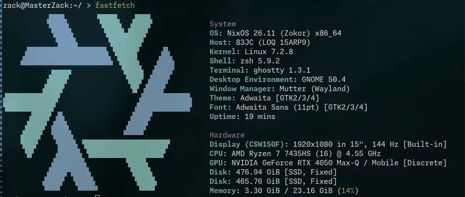

## Verdict (the only thing that matters)
On my machine (details in the fastfetch) the performance gain was only 3% in sampling. During startup the speed went down to 713 microseconds from 911 microseconds, but that's not perceivable for us humans. The only thing that the temporion daemon does is read temps from `/sys/class/hwmon/` except for nvidia because nvml. On the other hand, the task that was done by a clean and simple rust codebase is now done by a not-so-readable assembly file. While the workload here is small and in other workloads where maximum performance is a must even if it is a 3% gain (such as Games), assembly doesn't make much sense because porting will be very difficult in this x86 vs aarch64 era. Again, the codebase will be not-so-readable.

## fastfetch

